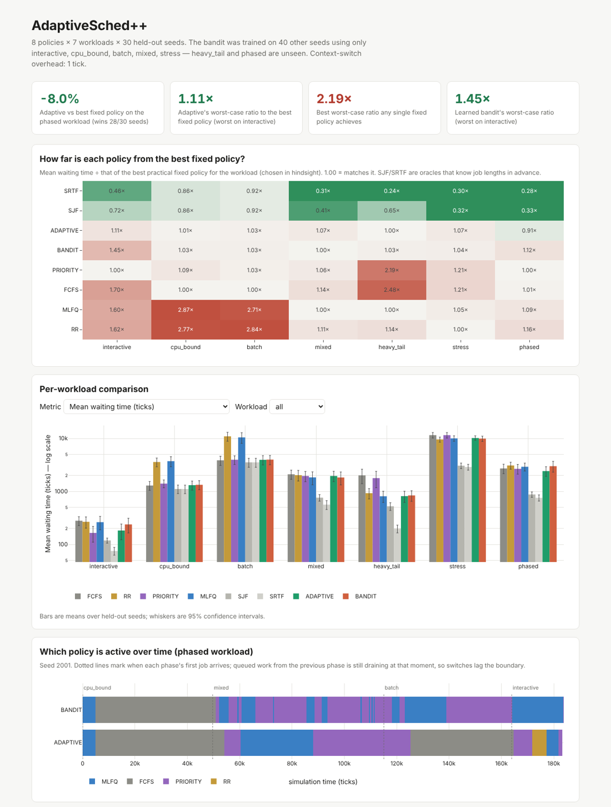

# AdaptiveSched++

A deterministic CPU-scheduling simulator in C++17 with two **meta-schedulers** that switch between scheduling policies at runtime:

- **Adaptive**: rule-based. It scores FCFS, Round-Robin, Priority and MLFQ from workload signals a real kernel could observe, such as service-time variance, interactivity, whether priorities predict job length, and waiting age.
- **Bandit**: learned. It's a contextual ε-greedy bandit that learns which policy to use in which situation. It's trained on one set of random seeds and evaluated on held-out seeds, including workloads it never saw.

Both are benchmarked against six fixed policies (FCFS, RR, Priority with aging, MLFQ, plus SJF and SRTF as oracle lower bounds) on seven workloads × 30 held-out seeds, with 95% confidence intervals.

**Headline result (held-out seeds):** no single fixed policy is good everywhere. Each one is **2.2–2.9× worse than the best choice** on at least one workload. The Adaptive scheduler never does worse than **1.11×** the best fixed policy for the workload (geometric mean 1.03×). On a workload whose behaviour changes over time, it **beats the best fixed policy by 8.0% ± 2.2%** (28 of 30 seeds), because no single fixed policy is right for every phase.

```
build/  → adaptive_sched (CLI), sched_tests (20 unit tests)
python3 benchmark.py          # trains the bandit, runs 1,680 simulations (~10 s), writes tables
python3 generate_dashboard.py # interactive HTML report
```

### 📊 [Live benchmark dashboard](https://YOUR-USERNAME.github.io/YOUR-REPO/)

[](https://ufoblivr.github.io/YOUR-REPO/)

---

## Quick start

Requirements: a C++17 compiler, CMake ≥ 3.16, and Python 3.8+ (standard library only).

```bash
cmake -S . -B build -DCMAKE_BUILD_TYPE=Release
cmake --build build -j
ctest --test-dir build --output-on-failure        # 20 tests

./build/adaptive_sched --workload phased --policy adaptive --trace
python3 benchmark.py && python3 generate_dashboard.py
# open output/adaptivesched_dashboard.html (also copied to docs/index.html for GitHub Pages)
```

On Windows, use WSL (the steps above work unchanged) or Visual Studio's CMake support. A `Debug` build enables AddressSanitizer and UBSan, and CI runs both build types on Linux and macOS.

### CLI

```
--workload <name>      interactive | cpu_bound | batch | mixed | heavy_tail | stress | phased
--csv <path>           load processes from CSV (pid,name,arrival,burst,priority,interactive)
--policy <name>        fcfs | sjf | srtf | rr | priority | mlfq | adaptive | bandit
--seed / --count / --load        workload generator controls
--quantum <n>          RR quantum (default 20)       --aging <n>   priority aging interval (default 100)
--ctx-overhead <n>     ticks lost per context switch (default 1)
--bandit-model <path>  Q-table to use                --bandit-train   explore + update + save
--json  --trace  --export-csv  --export-timeline  --output-dir <dir>  --dump-workload <path>
```

Examples:

```bash
# Textbook check: Silberschatz's SRTF example gives an average wait of 6.5
./build/adaptive_sched --csv workloads/textbook_srtf.csv --policy srtf --ctx-overhead 0

# Watch the adaptive scheduler react to phase changes
./build/adaptive_sched --workload phased --seed 2001
#   t=5000    MLFQ -> FCFS      [HOMOGENEOUS]  FCFS=1.00 MLFQ=0.40 ...
#   t=54200   FCFS -> PRIORITY  [INTERACTIVE]  PRIORITY=0.86 MLFQ=0.79 ...
#   t=125200  PRIORITY -> FCFS  [HOMOGENEOUS]  ...
```

---

## Architecture

```
include/ src/
├── core/        process.h (PCB), ready_queue.h (ordered, deterministic tie-breaking), state.h
├── scheduler/   scheduler.h (IScheduler contract)
│                fcfs.h  sjf.h (SJF + SRTF)  rr.h  priority.h (preemptive + aging)  mlfq.h
│                adaptive.h/.cpp  (MetaScheduler base + rule-based AdaptiveScheduler)
│                bandit.h/.cpp    (learned BanditScheduler)
├── execution/   cpu.h/.cpp       (CPUEngine: the tick loop, dispatch, context-switch cost)
├── metrics/     statistics.h/.cpp (percentiles, slowdown, Jain fairness, CSV/JSON export)
└── simulation/  workload.h/.cpp  (Poisson arrivals at a target load, 4 burst distributions, phases)
                 simulation_controller.h/.cpp
tests/test_main.cpp   benchmark.py   generate_dashboard.py   workloads/*.csv
```

The design separates **mechanism from policy**. The `CPUEngine` owns time, dispatch, preemption mechanics and context-switch cost. A scheduler only answers two questions: *who runs next?* and *should the running process be preempted now?* Each tick runs in this order:

1. admit arrivals → 2. preemption check → 3. dispatch if the CPU is free → 4. execute one tick → 5. scheduler bookkeeping (aging, MLFQ boosts, meta-policy evaluation).

A **context switch** costs `--ctx-overhead` ticks (default 1) every time the CPU is handed to a *different* process. Re-dispatching the same process, for example when a quantum expires with nobody else waiting, is free. Time is scaled so a switch costs about 1–10% of a time slice (quanta are 10–40 ticks), roughly the ratio in real systems.

### The policies

| Policy | Preemptive | Needs burst lengths? | Notes |
|---|---|---|---|
| FCFS | no | no | convoy effect with mixed job sizes |
| SJF / SRTF | no / yes | **yes (oracle)** | SRTF is optimal for mean waiting time, so it serves as the lower bound |
| RR | yes | no | quantum 20; requeues only if someone else is waiting |
| Priority | yes | no | aging: −1 priority level per 100 ticks waiting; boost kept while running |
| MLFQ | yes | no | 4 levels, quanta 10/20/40/∞, global boost every 1000 ticks (OSTEP rules) |
| Adaptive | via sub-policy | no | rule-based selection among FCFS/RR/Priority/MLFQ |
| Bandit | via sub-policy | no | learned selection among the same four |

### Adaptive scheduler

Every 200 ticks the `MetaScheduler` summarises the last window into metrics it is allowed to observe. It never looks at a job's remaining burst.

| Signal | How it's measured | What it suggests |
|---|---|---|
| service-time CV | bias-corrected EMA of the service times of completed jobs | low → FCFS (time-slicing only adds overhead); high → favour short jobs (MLFQ) |
| interactive fraction | EMA over arrivals of the interactive hint | high → MLFQ / RR / Priority |
| priority ↔ service correlation | slow EMA of covariance(priority, observed service time) | high → urgent jobs are short, so Priority acts like a free SJF |
| oldest wait | max time any ready process has been waiting | far above typical → RR bounds the wait |

These are turned into continuous scores. A switch happens only if the winner beats the incumbent by **0.15** (hysteresis), after a **10-completion warm-up** and with an **800-tick cooldown**. When it switches, the ready queue is migrated without resetting anyone's remaining work or waiting age.

The rules come from queueing theory. For example, for nearly equal job sizes FCFS (M/D/1) beats processor sharing by about 2× at load 0.9, and the benchmark reproduces this: on `cpu_bound`, FCFS waits 1,293 ticks vs RR 3,582.

### Bandit scheduler (learned)

- **Context:** 3 CV buckets × 3 queue-depth buckets × 2 priority-informativeness buckets, plus a warm-up context (19 in total).
- **Arms:** FCFS, RR, Priority, MLFQ.
- **Reward:** completions − arrivals in the window, i.e. minus the change in the number of jobs in the system. By Little's law, mean turnaround is proportional to the time-average number of jobs in the system, so this directly rewards reducing the objective. Arrivals don't depend on the chosen policy, so subtracting them only reduces variance.
- **Training:** ε = 0.2 exploration, incremental-mean Q-values, 40 seeds × 5 stationary workloads.
- **Acting:** greedy, but only over Q-values backed by ≥ 50 observations. In an unfamiliar context it keeps the current policy rather than trusting a noisy estimate.

---

## Results

`python3 benchmark.py` reproduces these numbers in about 10 seconds. Protocol:

- 30 held-out seeds (2001–2030). Development and tuning used seeds 1–40 and 1001–1030; seeds 2001+ were only used for this final report.
- The bandit was trained only on `interactive, cpu_bound, batch, mixed, stress`. `heavy_tail` and `phased` are unseen.
- Context-switch overhead is 1 tick. "Best fixed" is the best practical policy (FCFS/RR/Priority/MLFQ) for that workload, chosen with hindsight. That's a strong baseline, because a real system wouldn't know the workload in advance.

### Mean waiting time (ticks)

| Workload | FCFS | RR | PRIORITY | MLFQ | SJF* | SRTF* | ADAPTIVE | BANDIT |
|---|---:|---:|---:|---:|---:|---:|---:|---:|
| interactive | 280 | 266 | **164** | 263 | 119 | 75 | 182 | 238 |
| cpu_bound | **1,293** | 3,582 | 1,406 | 3,709 | 1,111 | 1,109 | 1,311 | 1,333 |
| batch | **3,846** | 10,932 | 3,957 | 10,436 | 3,530 | 3,529 | 3,945 | 3,972 |
| mixed | 2,100 | 2,029 | 1,952 | **1,835** | 761 | 563 | 1,959 | 1,826 |
| heavy_tail | 2,009 | 926 | 1,780 | **811** | 524 | 198 | 812 | 838 |
| stress | 11,524 | **9,536** | 11,506 | 10,002 | 3,053 | 2,879 | 10,195 | 9,900 |
| phased | 2,709 | 3,086 | **2,670** | 2,918 | 875 | 758 | **2,420** | 2,997 |

\* oracle: knows every job's length in advance. **Bold** = best practical fixed policy, plus Adaptive where it beats it.

### Robustness: ratio to the best fixed policy for each workload

| Policy | Geometric mean | Worst case | Worst on |
|---|---:|---:|---|
| **ADAPTIVE** | **1.03×** | **1.11×** | interactive |
| BANDIT | 1.09× | 1.45× | interactive |
| PRIORITY | 1.18× | 2.19× | heavy_tail |
| FCFS | 1.29× | 2.48× | heavy_tail |
| MLFQ | 1.46× | 2.87× | cpu_bound |
| RR | 1.52× | 2.84× | batch |

### Paired comparison against the best fixed policy (95% CI over seeds)

| Workload | Best fixed | Adaptive | wins | Bandit | wins |
|---|---|---:|---:|---:|---:|
| interactive | Priority | +10.3% ± 4.3 | 0/30 | +46.5% ± 6.3 | 0/30 |
| cpu_bound | FCFS | +1.3% ± 0.4 | 0/30 | +3.0% ± 0.5 | 0/30 |
| batch | FCFS | +2.2% ± 1.3 | 0/30 | +3.0% ± 1.3 | 0/30 |
| mixed | MLFQ | +14.8% ± 5.1 | 5/30 | **−0.5% ± 0.5** | 20/30 |
| heavy_tail *(unseen by bandit)* | MLFQ | +0.1% ± 0.2 | 5/30 | +5.7% ± 5.6 | 12/30 |
| stress | RR | +8.6% ± 3.4 | 7/30 | +3.4% ± 0.9 | 2/30 |
| phased *(unseen by bandit)* | Priority | **−8.0% ± 2.2** | 28/30 | +10.6% ± 8.3 | 16/30 |

The robustness table is a ratio of *means*. This table averages *per-seed* ratios, which weights seeds with low waiting times more heavily, so the two can differ (on mixed, 1.07× vs +14.8%).

### What the results say

1. **No fixed policy wins everywhere, so adapting is worth it.** Time-slicing is about 3× worse than FCFS on equal-sized jobs, while FCFS is about 2.5× worse than MLFQ on heavy-tailed jobs. Adaptive stays within 11% of the best choice on every workload.
2. **Phase changes are where adaptation pays off.** On `phased`, Adaptive runs FCFS during CPU-bound phases and Priority or MLFQ during mixed and interactive phases, beating every fixed policy.
3. **Adaptation has a cost.** On stationary workloads Adaptive is 1–15% behind the hindsight-best policy, because of warm-up (it starts in MLFQ), detection lag, and choosing between Priority and MLFQ when both look good (mixed).
4. **The learned scheduler generalizes worse than the rules.** The bandit is best on `mixed`, where it trained, but trails Adaptive on the unseen `phased` workload and on `interactive`. Its per-window reward is myopic: it credits the policy that clears jobs fastest *now*, which doesn't always give the lowest mean wait. Before the ≥50-visit rule was added, the bandit was 78% worse on `heavy_tail`. It was trusting Q-values built from a handful of samples in contexts it had never really visited, a textbook case of distribution shift.
5. **The objective matters.** Both meta-schedulers optimise mean waiting time. On `mixed`, Adaptive often picks Priority, which gives interactive jobs a mean response of about 1,700 ticks vs 9 under MLFQ. Aggressive aging promotes long jobs to the same level as interactive ones. It's a genuine trade-off: on one `mixed` run, Priority with aging every 100 ticks gives interactive jobs a response of 498 ticks and a worst-case wait of 3,351; with aging off it's 3 ticks but a worst-case wait of 10,398 (`--aging` controls this). A latency-sensitive system would weight response time in the score.

The dashboard (`output/adaptivesched_dashboard.html`) shows all of this interactively: a robustness heatmap, per-metric bar charts with CIs, which policy is active over time on the phased workload, and the bandit's learned Q-table.

---

## Testing

`tests/test_main.cpp` (no external framework) has 20 tests:

- **Textbook worked examples** (Silberschatz, ch. 5) reproduced exactly: FCFS convoy (avg 17), SJF (7), SRTF (6.5), RR q=4 (5.67), preemptive priority.
- **Mechanism:** context-switch overhead is charged correctly; a process running alone under RR never switches; MLFQ rule 1 (a new short job preempts a demoted long job); MLFQ boosts fire; aging rescues a starving process that otherwise waits behind a continuous stream of urgent jobs.
- **Properties across every policy × workload:** every process completes; busy ticks = total burst; makespan = busy + switch + idle; start ≥ arrival; response ≤ waiting.
- **Optimality:** with zero overhead, SRTF's mean wait ≤ every other policy's (SRPT optimality).
- **Determinism:** the same seed gives byte-identical results.
- **Meta-schedulers:** Adaptive picks FCFS for homogeneous work and MLFQ for heavy-tailed work, and switches across phases; the bandit's model survives a save/load round trip.

---

## Design decisions

**Why single-threaded?** A discrete-time simulation has one logical clock, and every tick depends on the previous one, so there's no parallelism inside a run. Version 1 ran the CPU, the process generator and the monitor on three threads. The generator and monitor waited on wall-clock time while the CPU advanced simulated time, so arrivals and policy decisions depended on OS thread scheduling and every run gave different numbers. Making it single-threaded made runs reproducible. Parallelism now lives where it's real: the benchmark runs independent simulations concurrently.

**Why exclude SJF/SRTF from the meta-schedulers?** They need each job's burst length in advance, which an OS doesn't have. They're reported as oracle lower bounds instead.

**Why EMA + hysteresis + cooldown?** Moving averages filter noise. Hysteresis and cooldown stop the scheduler oscillating between two near-equal policies, which an early v2 iteration did on the interactive workload until the correlation signal was smoothed. The priority-correlation signal uses a slower average (about 50 jobs) because it's a structural property of the workload.

**Why a bandit rather than deep RL?** The decision is made once per window from a handful of features with 4 actions. A tabular contextual bandit is interpretable (the whole policy is a 19×4 table you can read in the dashboard), trains in seconds, and is easy to analyse when it fails.

**Why Jain's index over `burst/turnaround`?** Version 1 used waiting times, which are often zero. The share of its time in the system that each job spent running, `x_i ∈ (0,1]`, is a well-defined allocation to measure fairness on.

## Limitations

- Single CPU, CPU-bound bursts only (no I/O blocking), fixed 1-tick switch cost.
- Workloads are synthetic. Each is a stationary Poisson process (or a sequence of them) with chosen burst distributions. No real traces are included, but any trace can be loaded via `--csv`.
- Adaptive's score weights were hand-set from theory, then checked on training seeds. They aren't learned or formally optimised.
- The bandit's reward is myopic (one window), and its contexts are coarse buckets.
- `std::*_distribution` output differs between standard libraries, so generated workloads match across runs on one platform but not between, e.g., GCC and MSVC. Use `--dump-workload` / `--csv` to share an exact workload.